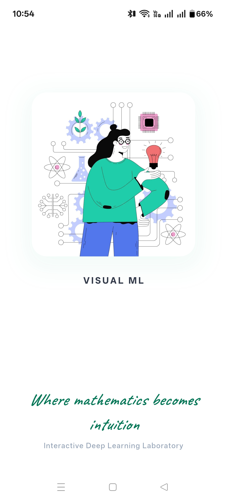
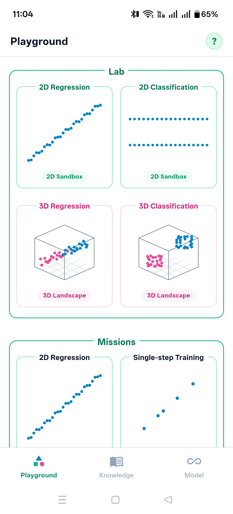
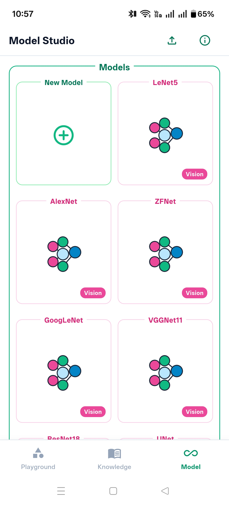
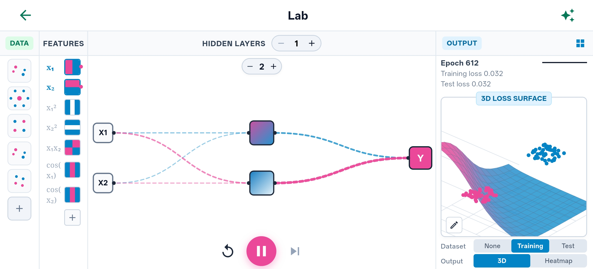
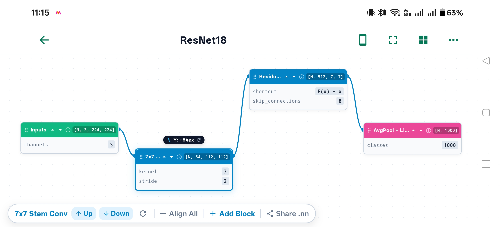
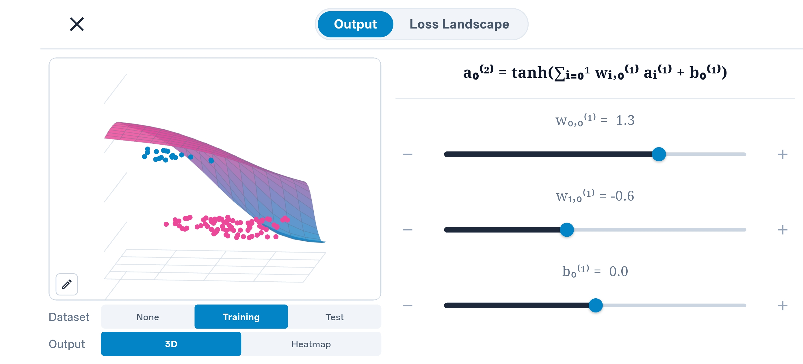
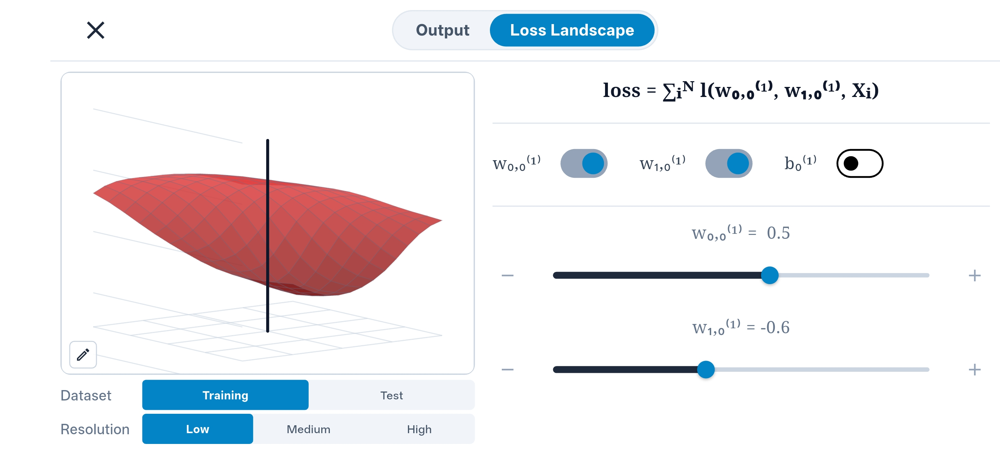
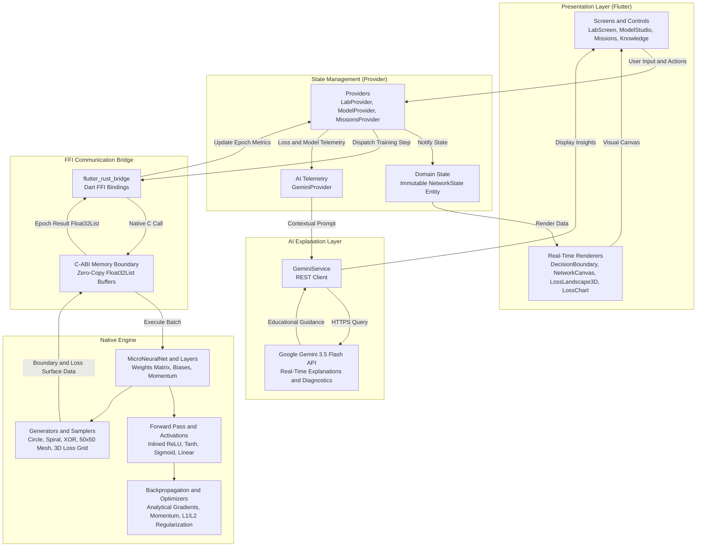

# Visual ML

Visual ML is an interactive deep learning laboratory and neural network simulator built with Flutter and Rust.

This project is built for understanding how machine learning mathematics, optimization algorithms, and computer vision architectures operate under the hood in real time, while making deep learning accessible and visual.

  

## Features
- **Interactive Neural Network Lab**  
  Construct multi-layer perceptrons by adding or removing hidden layers and adjusting neuron counts. Watch decision boundary contours evolve in real time as weights adapt during training.

- **Synthetic Datasets and Feature Engineering**  
  Experiment on five distinct classification datasets: Linear, Circle, XOR, Sinewave, and Spiral. Toggle raw coordinates, polynomial features, and trigonometric transforms to understand non-linear boundary separation.

- **3D Loss Surface and Optimization Tracking**  
  Switch to an interactive 3D loss landscape to observe gradient descent trajectories rolling down optimization basins toward minimum loss.

- **Model Studio and Landmark Vision Architectures**  
  Explore visual pipelines of benchmark convolutional neural network architectures including LeNet-5, AlexNet, VGG-16, GoogLeNet, and ResNet-50. Inspect tensor dimensions at each layer and simulate vision training on digit classification benchmarks.

- **High-Performance Native Rust Core**  
  All matrix algebra, forward propagation, loss calculations, and analytical backpropagation derivatives execute natively in compiled Rust via Foreign Function Interface (FFI) for sub-millisecond execution on mobile CPUs.

- **Context-Aware Gemini AI Tutor**  
  An integrated educational mentor that inspects active screen hyperparameters, dataset configurations, and loss convergence curves to explain the mathematics and diagnose training behavior.

## Tech Used
- Flutter
- Dart
- Rust 
- Provider (State Management)
- Google Fonts
- Gemini API

## Screenshots

| Splash | Playground | Model Studio |
|:---:|:---:|:---:|
|  |  |  |

| Lab | Visual Model |
|:---:|:---:|
|  |  |

| Output | Loss Landscape |
|:---:|:---:|
|  |  |

## Architecture

### System Architecture Breakdown

- **Presentation Layer (Flutter)**: Handles UI interactions, hyperparameter selection, dataset generation triggers, and real-time canvas rendering for decision boundary contour heatmaps, synaptic network graphs with animated Bezier curves, and 3D loss surface topography.
- **State Management (Provider)**: Coordinates application state through immutable `NetworkState` entities, runs the asynchronous training loop timer, batches data updates, and routes telemetry to the UI and AI services.
- **FFI Communication Bridge (flutter_rust_bridge)**: Facilitates low-latency cross-language communication between Dart and compiled Rust over C-ABI boundaries, passing numeric arrays (`Float32List`) without JSON serialization overhead.
- **Native Computational Engine (Rust)**: Executes all CPU-intensive mathematical operations natively. Utilizes `ndarray` for matrix algebra, evaluates forward inference, performs analytical backpropagation with momentum and regularization, and samples both the 50x50 decision space and 3D loss landscapes.
- **AI Explanation Layer**: Integrates Google Gemini 3.5 Flash to inspect live screen context, hyperparameters, and loss metrics, generating real-time explanations and training diagnostics.

## Privacy
This app does not collect or share any personal data.  
All neural network training computations are executed locally on the device.

